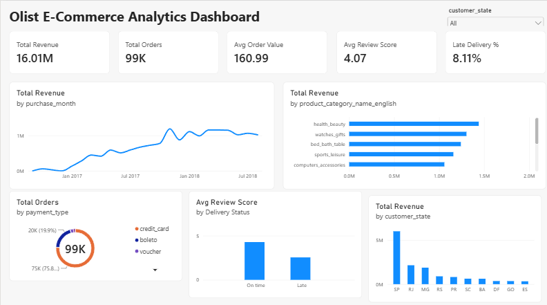

# Big Data Analytics & Predictive Intelligence: Olist E-Commerce

Author: Santosh Bhandari

## Project Overview
End-to-end analytics project on the Brazilian E-Commerce dataset by Olist (about 100k orders, 2016 to 2018). The project covers data merging, cleaning, feature engineering, SQL analysis, a machine learning model to predict late deliveries, and an interactive Power BI dashboard.

## Dataset
Source: [Brazilian E-Commerce Public Dataset by Olist (Kaggle)](https://www.kaggle.com/datasets/olistbr/brazilian-ecommerce)

8 tables were used: customers, orders, order items, payments, reviews, products, sellers, and category translation. The geolocation table was not used.

## Tools Used
- Python (Pandas, NumPy, Matplotlib, Seaborn, Scikit-learn)
- SQL (SQLite, run from Python)
- Power BI Desktop
- VS Code and Jupyter Notebook

## Workflow
1. Loaded the 8 tables and merged them into one order-level dataset. Payments and reviews were aggregated per order first to avoid duplicate rows.
2. Cleaned data: parsed dates, translated category names to English, handled missing values.
3. Feature engineering: delivery days, estimated delivery days, late delivery flag, purchase month, same-state flag.
4. Calculated business KPIs.
5. Ran SQL queries for top categories and monthly revenue.
6. Built a Random Forest model to predict late deliveries.
7. Exported a cleaned file and built a Power BI dashboard.

## Dashboard


## Key Business KPIs
| KPI | Value |
|---|---|
| Total Orders | 99,441 |
| Unique Customers | 96,096 |
| Total Revenue | about 16.01 million BRL |
| Average Order Value | 160.99 BRL |
| Average Review Score | 4.07 |
| Late Delivery Rate (delivered orders) | 8.11% |
| Repeat Customers | 3.12% |

Note: the notebook prints 7.91% late deliveries because it counts at item level (one order with 3 items is counted 3 times). The dashboard shows 8.11%, which is counted at order level and is the correct figure.

## Key Insights
- **Health & Beauty** is the top revenue category, followed by Watches & Gifts and Bed Bath Table.
- **Late delivery hurts satisfaction.** Late orders average a review score of about 2.5, versus above 4 for on-time orders.
- **Retention is weak.** Only 3.12% of customers placed more than one order.
- **Credit card** is the dominant payment method (about 76% of orders).
- **Sao Paulo (SP)** generates the highest revenue by a large margin, followed by RJ and MG.

## Machine Learning Model
Goal: predict whether an order will be delivered late.
Model: Random Forest Classifier (class weights balanced).

| Metric | Value |
|---|---|
| Accuracy | about 0.73 |
| ROC-AUC | about 0.73 |
| Recall (late orders) | about 0.60 |
| Precision (late orders) | about 0.16 |

The model is a modest baseline. Only about 8% of orders are late, so precision for late orders is low. It catches most late orders but also flags many on-time orders. The most important features were estimated delivery days, freight value, and price.

## Recommendations
- Improve logistics for distant states and high-freight orders to cut late deliveries.
- Set more realistic delivery estimates, since estimated days is the top predictor of lateness.
- Launch retention campaigns (discounts, loyalty offers) because repeat purchase rate is very low.
- Focus inventory and marketing on top categories such as Health & Beauty.

## Folder Structure
```
TASK 3/
├── Data/          raw CSV files and cleaned_for_powerbi.csv
├── Notebook/      01_analysis_and_model.ipynb
├── Dashboard/     olist_dashboard.pbix
├── images/        charts and dashboard screenshot
└── README.md
```

## How to Run
1. Download the dataset from the Kaggle link above and place the CSV files in the `Data` folder.
2. Open `Notebook/01_analysis_and_model.ipynb` and run the cell.
3. Open `Dashboard/olist_dashboard.pbix` in Power BI Desktop.
